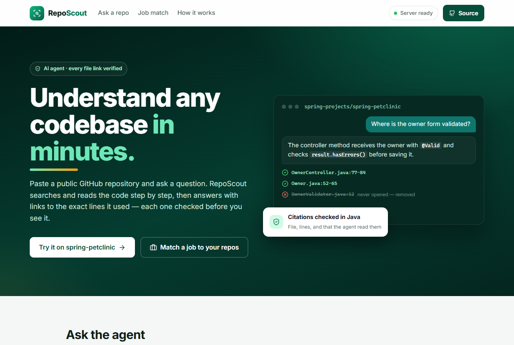
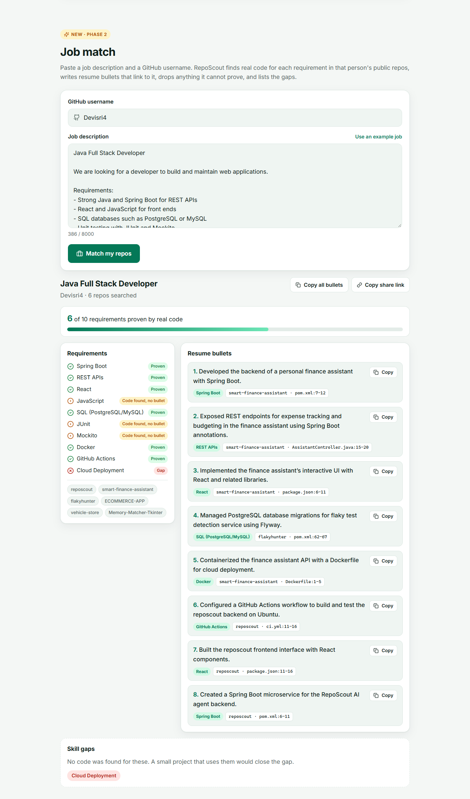
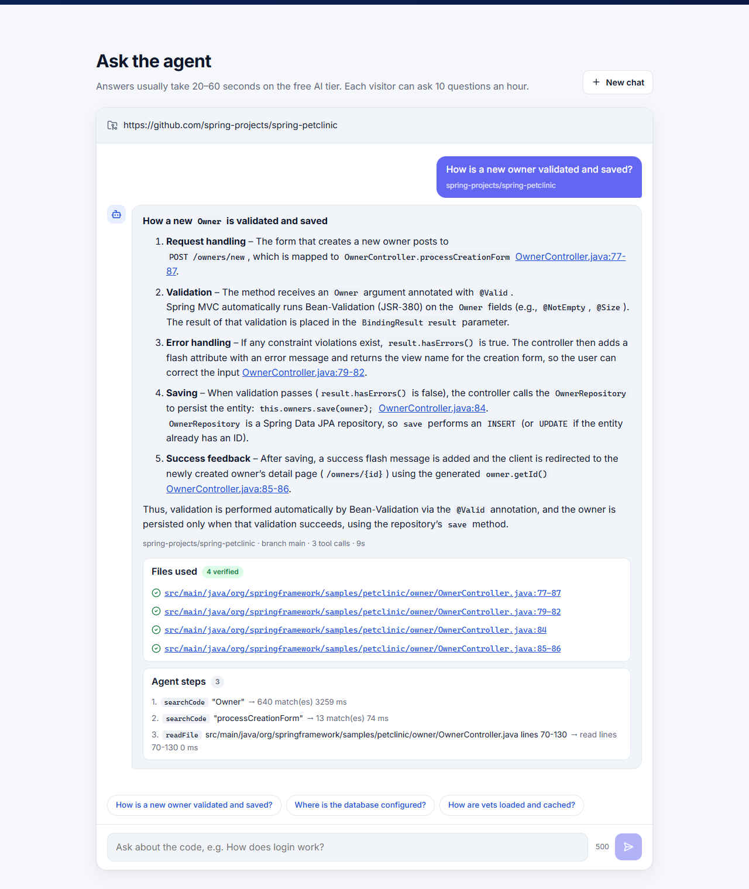
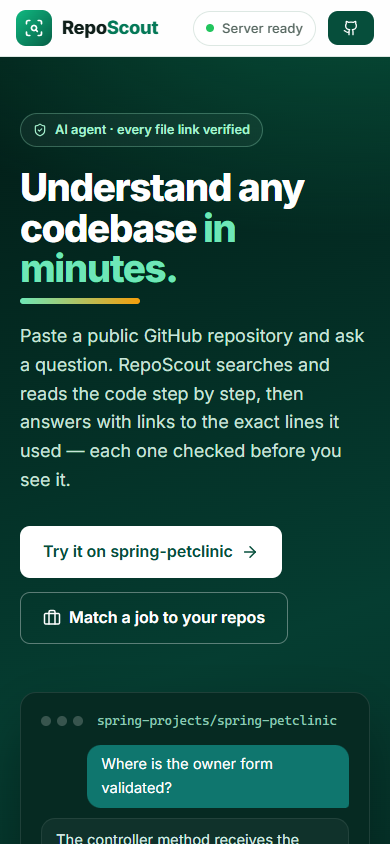

# RepoScout

[](https://github.com/Devisri4/reposcout/actions/workflows/ci.yml)

AI agent that explains any public GitHub repo and turns your own repos into proven resume bullets.
Every file link it shows is checked in plain Java first.

**Live demo: https://reposcout-nine.vercel.app** <sub>(free hosting — the first request can take a minute while the server wakes up)</sub>



## Features

- **Ask a repo** — paste a repo link and a question. The agent searches and reads the code step by step,
  then answers with links to the exact lines. Links to files or lines it never read are removed.
- **Job match** — paste a job description and a GitHub username. RepoScout finds real code for each requirement,
  writes resume bullets that link to it, drops claims it cannot prove, and lists skill gaps. Results get a share link.



| Answer with verified file links | On a phone |
|---|---|
|  |  |

## How it works

1. **Ask:** Spring AI lets the model call three Java tools (`listFiles`, `searchCode`, `readFile`) on a safely
   unpacked copy of the repo. A citation checker then verifies every `[file:lines]` against what was really read.
2. **Job match:** one AI call extracts the requirements, Java searches your public repos for evidence, a second
   AI call writes bullets that may only cite that evidence, and Java drops anything unproven. Results are saved in Postgres.

## Tech stack

| | |
|---|---|
| Backend | Java 21, Spring Boot 3.5, Spring AI 1.1 (tool calling, structured output), Spring Data JPA, Flyway |
| AI | Groq free tier, model `openai/gpt-oss-120b` |
| Frontend | React 18, Vite 5 |
| Database | PostgreSQL on Neon (H2 locally) |
| Testing | JUnit 5, Mockito, MockMvc, Testcontainers, Vitest — 141 backend + 11 frontend tests |
| CI/CD and hosting | GitHub Actions, Docker, Render (API), Vercel (page) |

Security: zip-slip and zip-bomb protection, paths sandboxed to the repo folder, per-visitor rate limit,
CORS locked to the site, keys only from environment variables.

## Run it locally

```bash
cd backend && cp .env.example .env     # add a free Groq key: https://console.groq.com/keys
./mvnw spring-boot:run                  # API on :8080
cd ../frontend && npm install && npm run dev   # page on :5173
```

Environment variables: `GROQ_API_KEY` (required), `GITHUB_TOKEN`, `DATABASE_URL`, `FRONTEND_ORIGIN`, `VITE_API_URL`.
